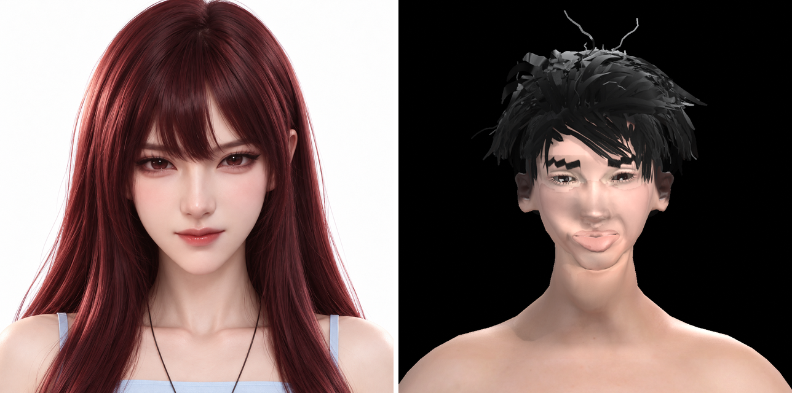
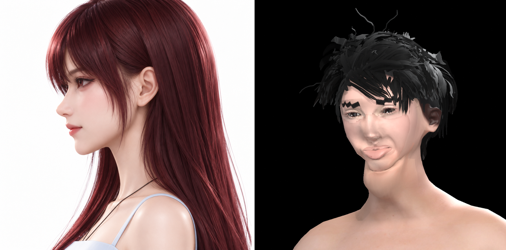
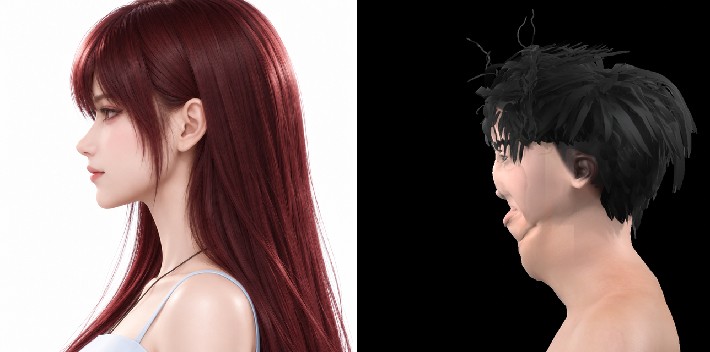
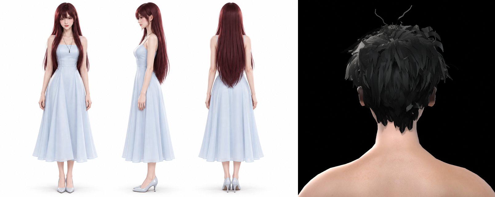
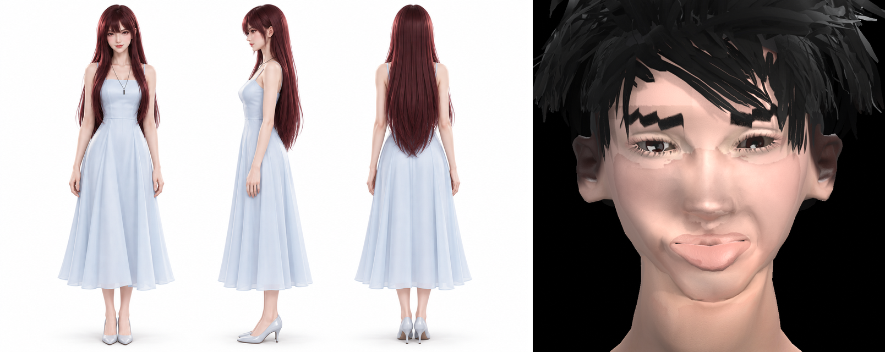

# 女主 lin（Blender lookdev 临时验收）

- 生成：`Tools/qa/run_blender_preview_report.py lin`（DeepSeek D10）
- 渲染：`/Users/shoudaodefengge/.local/share/hunyuan3d/work/fit`，`female_look_{front,q34,side,back,closeup}.png`
- 性质：**临时验收**（Blender lookdev 渲染，不是 MetaHuman/UE 最终渲染；Codex 的对比相机就绪后以 `report.py` 为准）
- 结论：**存在 FAIL**

## PASS / FAIL 表

| 视角 / 指标 | 数值 | 阈值 | 判定 | 说明 |
|-------------|------|------|------|------|
| front 关键点平均误差 | 7.74 px | ≤ 3 px | FAIL | max 25.6 / p95 20.1 |
| front 头发剪影 IoU | 0.399 | ≥ 0.85 | FAIL | 对比 D7 参考头发掩码 |
| q34 关键点平均误差 | 37.28 px | ≤ 8 px | FAIL | max 139.2 / p95 82.1 |
| side 脸部剪影 IoU | 0.246 | ≥ 0.95 | FAIL | 白底前景去掉头发；临时渲染构图可能不一致 |
| side 头发剪影 IoU | 0.322 | ≥ 0.85 | FAIL | 对比 D7 参考头发掩码 |

## 并排图（左=参考，右=当前渲染）

## 临时验收说明

- 本报告用于 Claude 在 MetaHuman 交付前跟踪 Blender 阶段进度，数值只作趋势参考。
- 构图/焦距/背景与参考图不完全一致时，剪影 IoU 会偏低；关键点误差受头部裁切影响。
