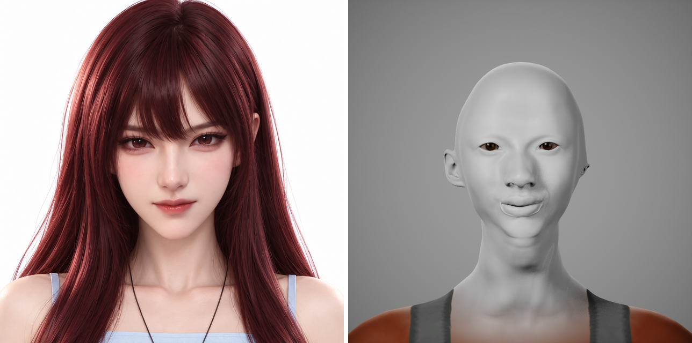
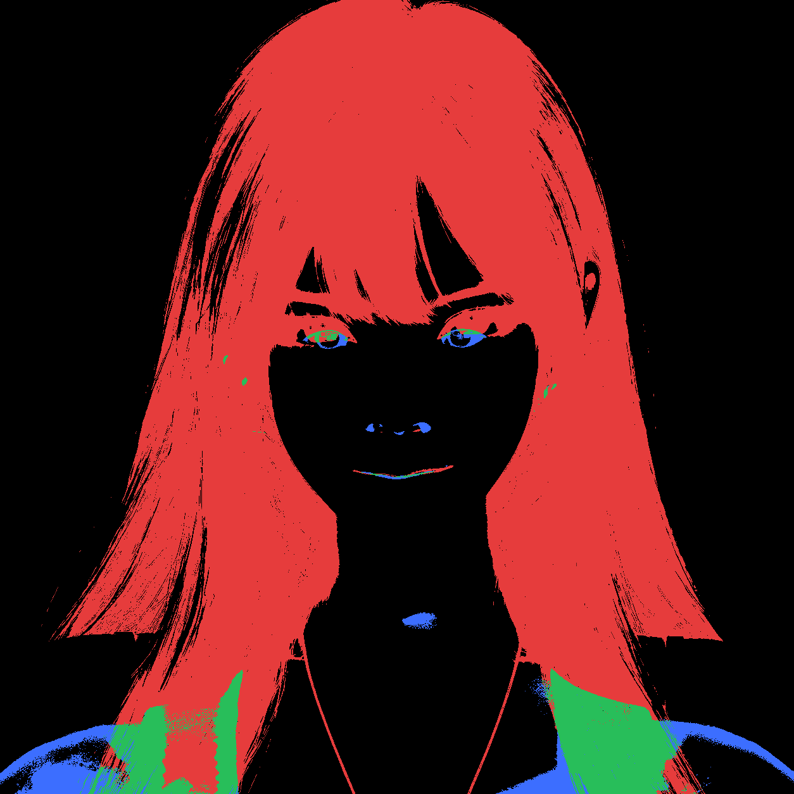
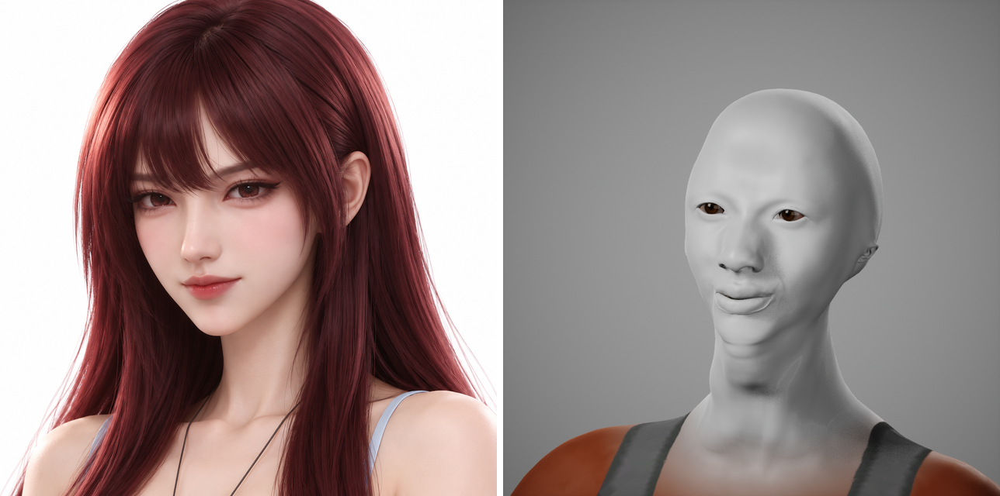
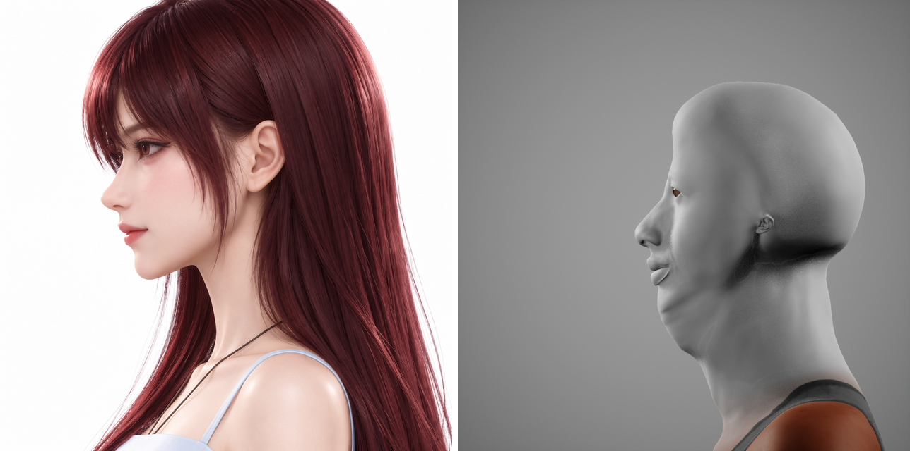
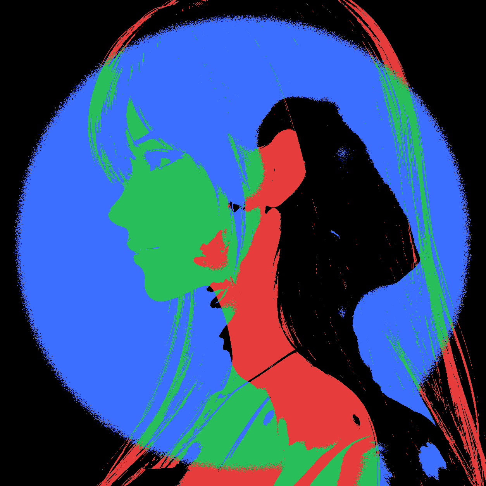
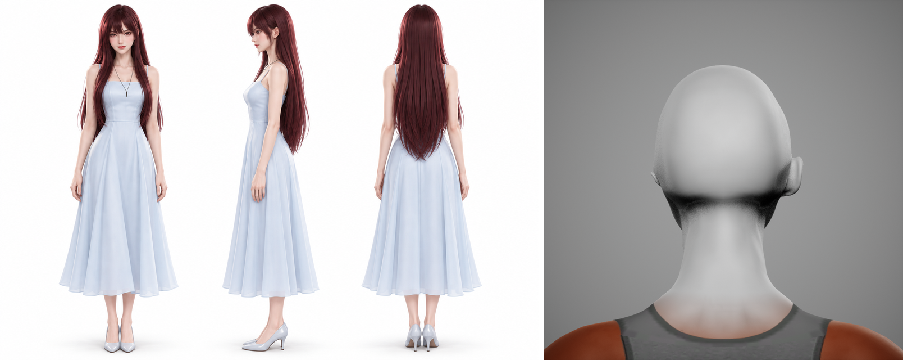
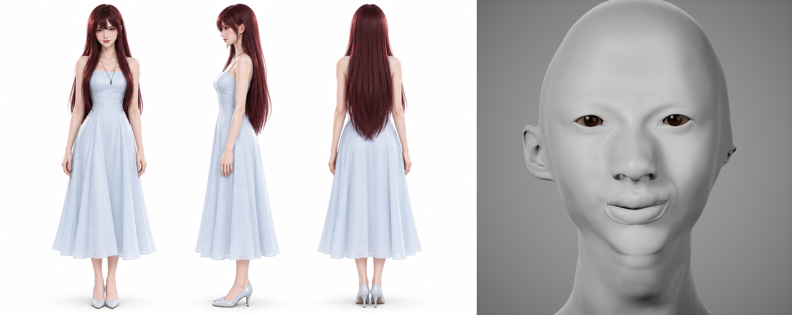

# 女主 lin 验收报告

- 生成：`Tools/qa/report.py lin`（DeepSeek D3）
- 渲染目录：`/Users/shoudaodefengge/项目/.claude/worktrees/game-memory/手机游戏/word-quest-ue/Saved/Compare/lin`
- 阈值来源：`Docs/character-production-plan.md` 第 4 节
- 结论：**存在 FAIL**

## PASS / FAIL 表

| 检查项 | 数值 | 阈值 | 判定 | 说明 |
|--------|------|------|------|------|
| front 关键点平均误差 | 7.88 px | ≤ 3 px | FAIL | max 24.5 px / p95 16.6 px |
| front 头发剪影 IoU | 0.069 | ≥ 0.85 | FAIL | 暗色低饱和区域 |
| q34 关键点平均误差 | 7.13 px | ≤ 8 px | PASS | max 17.4 px / p95 13.0 px |
| side 脸部剪影 IoU | 0.218 | ≥ 0.95 | FAIL | 白底前景去掉头发 |
| back 并排图 | 已生成 | 人工检查 | N/A | 背面/特写以人工确认为准 |
| closeup 并排图 | 已生成 | 人工检查 | N/A | 背面/特写以人工确认为准 |

## 并排图与差异图

## 人工检查项（未自动判定）

- [ ] 发丝是否有碎片/发片边缘
- [ ] 眼睛高光与虹膜质感
- [ ] 牙齿与口腔
- [ ] 表情极值（眨眼/张嘴/微笑）
- [ ] 布料自交与穿模
- [ ] LOD 远近切换
- [ ] 1440p Lumen 下单英雄 LOD0 ≤ 2.5 ms GPU
